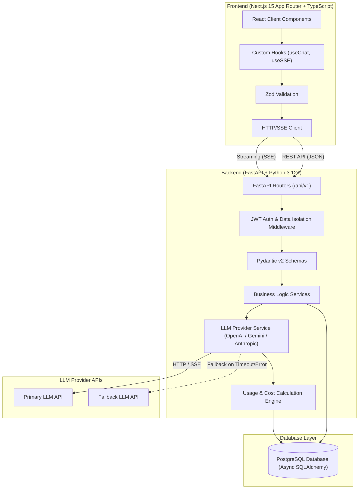
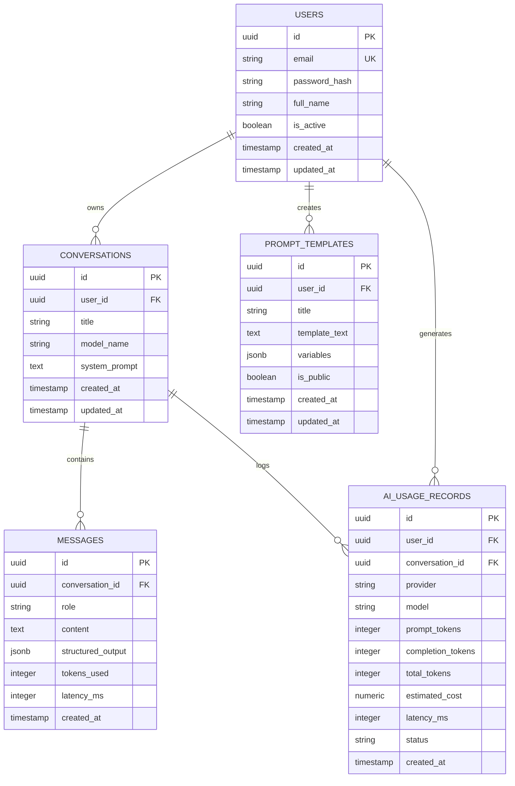

# AI-Powered Full-Stack Application: Architecture & Phase Plan (Phase 0)

## 1. Executive Summary & Overview
This document specifies the complete system architecture, data models, API protocols, security design, dependency choices, and phase roadmap for the **AI-Powered Full-Stack Application**. The platform provides real-time streaming AI chat responses, structured JSON output extraction, reusable prompt template management, and automated token cost tracking with resilient fallback handling.

---

## 2. High-Level System Architecture



---

## 3. Directory Structure & Responsibilities

```
ai-powered-fullstack-app/
├── docs/
│   └── ARCHITECTURE.md           # Master Architecture & Phase Planning (Phase 0)
├── frontend/                     # Next.js Frontend Application
│   ├── public/                   # Static assets
│   ├── src/
│   │   ├── app/                  # App Router pages and layouts
│   │   │   ├── (auth)/           # Authentication route group (login, register)
│   │   │   ├── (dashboard)/      # Protected user dashboard (chat, templates, analytics)
│   │   │   └── api/              # Optional BFF proxy routes
│   │   ├── components/           # UI Components
│   │   │   ├── ui/               # Reusable atomic UI elements (Button, Input, Card)
│   │   │   ├── chat/             # Chat UI components (MessageList, ChatInput, StreamViewer)
│   │   │   ├── templates/        # Prompt template forms and cards
│   │   │   └── analytics/        # Usage and cost visualization widgets
│   │   ├── hooks/                # Custom React hooks (useAuth, useChatStream, useTemplates)
│   │   ├── lib/                  # Utility functions, API fetch client wrappers
│   │   └── types/                # TypeScript interface definitions & schema types
│   ├── package.json
│   ├── tsconfig.json
│   └── tailwind.config.js
├── backend/                      # FastAPI Backend Application
│   ├── app/
│   │   ├── api/                  # API endpoints grouped by domain
│   │   │   └── v1/
│   │   │       ├── auth.py       # Authentication endpoints (login, register, refresh)
│   │   │       ├── conversations.py # Conversation management
│   │   │       ├── messages.py   # Chat messages & SSE streaming endpoint
│   │   │       ├── templates.py  # Reusable prompt templates
│   │   │       └── analytics.py  # Usage and cost tracking analytics
│   │   ├── core/                 # App-wide configurations and security
│   │   │   ├── config.py         # Settings & environment variable loader
│   │   │   ├── security.py       # Password hashing, JWT token creation/verification
│   │   │   ├── db.py             # SQLAlchemy async engine & session generator
│   │   │   └── exceptions.py     # Custom error handlers & HTTP exception mappings
│   │   ├── models/               # SQLAlchemy ORM database entities
│   │   │   ├── user.py
│   │   │   ├── conversation.py
│   │   │   ├── message.py
│   │   │   ├── template.py
│   │   │   └── usage.py
│   │   ├── schemas/              # Pydantic v2 schemas for request/response validation
│   │   │   ├── user.py
│   │   │   ├── conversation.py
│   │   │   ├── message.py
│   │   │   ├── template.py
│   │   │   └── usage.py
│   │   ├── services/             # Business logic & domain abstractions
│   │   │   ├── llm_service.py    # LLM provider wrapper (streaming, JSON mode, retry, fallback)
│   │   │   ├── prompt_service.py # Prompt template variable interpolation
│   │   │   └── usage_service.py  # Cost and token tracking recorder
│   │   └── main.py               # FastAPI application entrypoint & middleware configuration
│   ├── alembic/                  # Database migration scripts
│   ├── tests/                    # Backend test suites (unit, integration, mock LLM)
│   ├── alembic.ini
│   └── pyproject.toml / requirements.txt
└── docker-compose.yml            # Multi-container orchestration (Future Phase)
```

---

## 4. API Communication Protocol: Next.js & FastAPI

### 4.1 REST API Endpoints

| Method | Endpoint Path | Description | Access |
|---|---|---|---|
| `POST` | `/api/v1/auth/register` | User registration | Public |
| `POST` | `/api/v1/auth/login` | Authenticate user & issue JWT | Public |
| `POST` | `/api/v1/auth/refresh` | Refresh access token | Public (Refresh Cookie) |
| `GET` | `/api/v1/conversations` | List user's conversations | Protected |
| `POST` | `/api/v1/conversations` | Create new conversation | Protected |
| `GET` | `/api/v1/conversations/{id}` | Get conversation with messages | Protected |
| `DELETE` | `/api/v1/conversations/{id}` | Delete conversation | Protected |
| `GET` | `/api/v1/templates` | List prompt templates | Protected |
| `POST` | `/api/v1/templates` | Create custom prompt template | Protected |
| `GET` | `/api/v1/analytics/usage` | Fetch user token & cost analytics | Protected |

### 4.2 Streaming Response Architecture (SSE)
For real-time AI responses, FastAPI will expose an Server-Sent Events (SSE) endpoint:
- **Endpoint**: `POST /api/v1/messages/stream`
- **Headers**: `Content-Type: text/event-stream`, `Cache-Control: no-cache`, `Connection: keep-alive`
- **Data Payload Standard**:
  - `event: token` -> `data: {"content": "Hello"}`
  - `event: metadata` -> `data: {"usage": {"prompt_tokens": 12, "completion_tokens": 4, "total_cost": 0.00003}, "latency_ms": 420}`
  - `event: done` -> `data: {"message_id": "uuid-v4"}`
  - `event: error` -> `data: {"error": "LLM Provider Timeout", "code": "TIMEOUT"}`

---

## 5. PostgreSQL Database Entities Specification (Proposed)



### Entity Detail Specifications
1. **User**: Stores account credentials, activation status, and metadata.
2. **Conversation**: Groups user messages under a specific system prompt and chosen AI model.
3. **Message**: Contains individual user prompts and assistant outputs (text or structured JSONB).
4. **PromptTemplate**: Reusable prompt schemas containing variable placeholders (e.g., `{{topic}}`, `{{tone}}`).
5. **AIUsageRecord**: Tracks token consumption, response latency (ms), calculated API cost, and execution status (`success`, `timeout`, `error`, `fallback`).

---

## 6. Security, Isolation, and Validation Architecture

1. **Authentication (Planned for Phase 2)**:
   - **Access Token**: Short-lived JWT Access Tokens (15 min lifespan) signed with RS256 or HS256, transmitted via `Authorization: Bearer <token>` headers for REST and SSE connection handshakes.
   - **Refresh Token**: HTTP-only, `SameSite=Strict`, `Secure` Refresh Cookies (7-day lifespan) with automatic token rotation and revocation list in Redis/PostgreSQL.
   - **Password Security**: Argon2id or Bcrypt hashing with high work factor (salt + pepper support).
   - **Session Control**: Logout endpoint invalidates refresh session server-side.
2. **User Data Isolation**:
   - Every service layer query enforces tenant isolation at SQL level: `WHERE user_id = current_user.id`.
   - Prevents cross-user data leakage by default across conversations, messages, templates, and analytics.
3. **Input Validation**:
   - **Frontend**: Zod schemas validate UI forms, prompt templates, and chat input before sending network requests.
   - **Backend**: Pydantic v2 models sanitize, type-check, and bound incoming request payloads with strict constraint validation.
4. **Secrets Management**:
   - Centralized `pydantic-settings` class loading from environment variables (`.env`).
   - Strict rule: Secrets (`DATABASE_URL`, `JWT_SECRET`, `LLM_API_KEY`) are never stored in codebase or repository.

---

## 7. Phase Roadmap, Testing Strategy & Acceptance Criteria

### Phase 1: Project Foundation & Skeleton Setup
- **Goal**: Initialize Git repository, Next.js frontend with App Router & layout, FastAPI backend with `/health` endpoint & pytest, PostgreSQL Docker service setup, root README setup.
- **Acceptance Criteria**: Next.js builds cleanly (`npm run build`); FastAPI healthcheck (`/health`) returns HTTP 200 with pytest passing; PostgreSQL container starts and passes healthcheck (`docker compose up -d`).

### Phase 2: Database ORM Models & Auth System
- **Goal**: Implement SQLAlchemy async models (User, Conversation, Message, PromptTemplate, AIUsageRecord), Alembic migrations, JWT register/login/refresh endpoints, password hashing, and user data isolation middleware.
- **Acceptance Criteria**: User registration and login return valid JWTs; unauthorized requests return HTTP 401; unit & integration tests verify tenant isolation and password security.

### Phase 3: Conversation, Message & Template Management
- **Goal**: Build CRUD endpoints and database persistence for conversations, messages, and prompt templates with dynamic variable interpolation.
- **Acceptance Criteria**: Users can create, list, update, and delete conversations and prompt templates; message history persists cleanly; foreign key constraints enforce data isolation.

### Phase 4: LLM Integration, SSE Streaming & Resilience Pipeline
- **Goal**: Implement FastAPI LLM wrapper with SSE streaming, structured JSON extraction, per-chunk timeouts (no fixed 10s request timeout), exponential backoff retries, and provider fallback.
- **Acceptance Criteria**: Mocked LLM tests verify streaming chunks via SSE; structured JSON responses validate against target schemas; automatic fallback triggers upon primary provider failure; test suite covers error recovery.

### Phase 5: Frontend UI & Interactive Real-Time Experience
- **Goal**: Develop Next.js UI for chat interface, real-time response rendering hook, prompt template selector, and usage visualization widgets.
- **Acceptance Criteria**: Real-time text streams smoothly without UI flickering; structured output displays formatted JSON card; responsive layout across mobile and desktop.

### Phase 6: Cost Tracking, Dockerization & Automated Verification
- **Goal**: End-to-end token and cost calculation, Docker Compose multi-container environment, integration test suite execution with coverage reporting.
- **Acceptance Criteria**: `docker-compose up` launches full stack; automated test suite achieves >85% code coverage; complete token usage and cost metrics log correctly per request.

---

## 8. Minimum Required Dependencies

### Frontend (Next.js & TypeScript)
- `next`: React Framework for SSR and App Router.
- `react`, `react-dom`: UI rendering engine.
- `typescript`: Static type safety.
- `tailwindcss`, `postcss`, `autoprefixer`: Utility-first CSS styling.
- `lucide-react`: UI icon set.
- `zod`: Client-side schema validation.

### Backend (FastAPI & Python 3.12 / 3.13 / 3.14 Compatible)
- `fastapi`: High-performance asynchronous Web framework.
- `uvicorn[standard]`: Production ASGI web server.
- `pydantic`, `pydantic-settings`: Data parsing, validation, and settings management.
- `sqlalchemy`: Async SQL ORM for database mapping.
- `asyncpg`: High-performance PostgreSQL async driver.
- `alembic`: Database schema migration tool.
- `pwdlib[argon2,bcrypt]` / `pyjwt`: Secure password hashing & JWT token processing.
- `httpx`: Async HTTP client for streaming LLM requests and integration testing.
- `pytest`, `pytest-asyncio`: Automated backend unit/integration testing framework.

---

## 9. Risk Analysis & Mitigation

| Risk | Impact | Mitigation Strategy |
|---|---|---|
| LLM Latency / Provider Outages | High | Async SSE streaming, per-chunk heartbeat timeouts (dynamic, no fixed overall cap), retry logic, fallback provider |
| Data Leakage Between Users | High | Enforce mandatory `user_id` filtering in all database service layer methods |
| High LLM Usage Costs | Medium | Pre-calculate estimated cost before execution, enforce maximum token limits per message |
| SSE Reconnection Failures | Medium | Implement automatic reconnect and state re-synchronization hook in Next.js client |

---

## 10. Verification Steps for Phase 0 & Phase 1
1. **Directory Verification**: Verify `ai-powered-fullstack-app/docs/ARCHITECTURE.md` exists and contains full specifications.
2. **Boundary Compliance Verification**: Confirm zero runtime code outside Phase 1 requirements has been implemented.
3. **Phase 1 Verification**: Ensure frontend, backend, PostgreSQL, and tests meet acceptance criteria.

